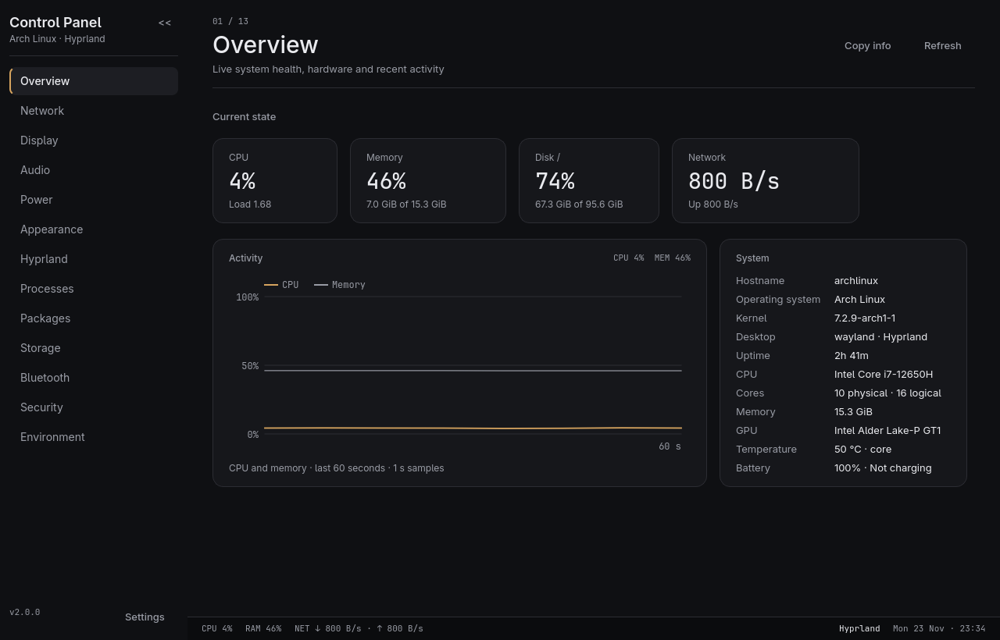

# Control Panel

A fast, responsive control panel for **Arch Linux + Hyprland**. One window for
system health, networking, audio, power, wallpapers, Hyprland settings,
processes, packages, storage, Bluetooth, security and environment variables.



More views: [network](docs/screenshots/network.png) ·
[appearance](docs/screenshots/appearance.png) ·
[Hyprland editor](docs/screenshots/hyprland.png) ·
[processes](docs/screenshots/processes.png)

> Polish version: [README.pl.md](README.pl.md)

## Why this rewrite?

The original prototype was a single 2,500-line script that ran almost every
system command on the GUI thread. Opening a page could freeze the window for
several seconds, and user-controlled text was interpolated into shell commands.

This version keeps the idea but changes the foundations:

- **Never blocks the GUI.** Commands run on a bounded `QThreadPool`; long tasks
  (package search, disk scan, Bluetooth scan) can be cancelled.
- **No shell injection.** Every command is an argument list. Nothing is passed
  through `shell=True`.
- **Responsive by design.** Cards wrap with a flow layout, the sidebar collapses
  on narrow windows, pages are lazy-loaded, and lists/tables adapt to space.
- **Safe privilege model.** Administrative actions use `pkexec` (desktop polkit
  agent) or open a real terminal for interactive work such as `pacman`/`yay`.
  A GUI process never waits for a password on a non-existent TTY.
- **Graceful degradation.** Missing tools are detected and explained instead of
  producing tracebacks or empty pages.
- **Safer editing.** Config files are written atomically and a `.bak` copy is
  kept. Hyprland config errors are shown after a reload.

Python + PyQt6 was kept on purpose: responsiveness comes from asynchronous I/O
and adaptive layouts, not from the language. A Rust/egui port would keep the
same design constraints while adding a large GUI/toolchain dependency. The
project is split into small modules to make such a port straightforward.

## Features

| Page | What it does |
| --- | --- |
| **Overview** | Live CPU/RAM/swap/disk/network/temperature/battery cards, history sparklines, hardware and OS facts |
| **Network** | Interface table, live throughput, DNS status, Cloudflare DNS, cache flush, WiFi scan/connect/disconnect/radio, ping, `nmtui` |
| **Display** | Backlight slider, detected monitors, editable Hyprland monitor rules, DPMS, night light |
| **Audio** | PipeWire/WirePlumber volume and microphone, mute, sinks/sources, default device, `playerctl` controls |
| **Power** | Live battery, `powerprofilesctl`, lock/suspend/hibernate/logout/reboot/shutdown with confirmation |
| **Appearance** | Wallpaper gallery with thumbnails, awww/swww/hyprpaper/swaybg, Matugen palette, GTK/icon/cursor themes, fonts |
| **Hyprland** | Editors for every sourced config file, dirty markers, backups, error reporting, live tweaks and live reload |
| **Processes** | Sortable process table with accurate CPU deltas, search, terminate/force-kill, system and user systemd services |
| **Packages** | Official + AUR search, install/remove in a terminal, update check and full upgrade |
| **Storage** | Filesystem usage bars, background largest-file scan with cancel, cache cleanup, paccache, journal vacuum |
| **Bluetooth** | Adapter status, power, scan, pair/connect/trust/remove |
| **Security** | Firewall status/actions, SSH config and keys, login history, listening ports and a checklist |
| **Environment** | Searchable environment with masked secrets, Hyprland `env.conf`, shell rc editor, PATH audit |

Keyboard: `Ctrl+1`…`Ctrl+9` jump to pages, `Ctrl+,` preferences, `Ctrl+R`
refresh, `Ctrl+Q` quit, `Ctrl+S` save in the Hyprland editor.

## Requirements

- Arch Linux (other distributions work for most pages, but package management
  and Hyprland-specific pages expect Arch tools).
- Python **3.11+**, PyQt6, psutil.
- Optional tools are detected at runtime; install only what you need:

```bash
sudo pacman -S --needed \
    python python-pyqt6 python-psutil \
    networkmanager brightnessctl \
    pipewire wireplumber playerctl \
    bluez bluez-utils pacman-contrib polkit \
    openssh ufw
```

For the full desktop experience:

```bash
yay -S --needed awww matugen hyprpaper wlsunset \
    ttf-jetbrains-mono-nerd noto-fonts
```

Recommended terminals: `kitty` (default in the screenshot), `alacritty`,
`foot`, `wezterm` or `xterm`. Any terminal that accepts `-e` is supported.

## Install

```bash
git clone https://github.com/Amirelox/Control-Panel-for-Arch-Linux.git control-panel
cd control-panel
./install.sh
```

`install.sh` creates a local `.venv`, installs the package, adds a launcher to
`~/.local/bin/control-panel` and a desktop entry to
`~/.local/share/applications`. Make sure `~/.local/bin` is in your `PATH`.

To uninstall the launcher (the checkout is kept):

```bash
./install.sh --uninstall
```

### Run without installing

```bash
./run.sh
```

The first run creates `.venv` and installs the two Python dependencies.

## CLI

```text
control-panel                 # normal start
control-panel --page Network  # open a page by name or 1-based number
control-panel --reset-layout  # forget geometry/last page
control-panel --self-test     # build every page and exit (CI)
control-panel --version
```

## Configuration

Settings live in `~/.config/control-panel/settings.json`:

- window geometry and last page,
- sidebar preference,
- refresh interval (0.5–5 s),
- accent source (`auto` follows `~/.config/hypr/colors.conf`),
- terminal preference,
- wallpaper folders,
- confirmation for destructive actions,
- large-file scan limit.

No configuration is written outside that file, except when you explicitly edit
a Hyprland or shell file. Those edits create `<file>.bak`.

## How it works

```text
src/control_panel/
├── app.py                 CLI, single instance, theme bootstrap
├── core/                  no Qt widgets
│   ├── commands.py        safe argv runner + thread pool
│   ├── privileged.py      pkexec / terminal helpers
│   ├── parsers.py         pure output parsers (unit tested)
│   ├── stats.py           psutil sampler on a QThread
│   ├── config.py          XDG paths + JSON settings
│   └── ...                network, audio, storage, security, ...
└── ui/
    ├── main_window.py     responsive shell, lazy pages, footer
    ├── sidebar.py         collapsible navigation
    ├── widgets.py         FlowLayout, cards, tables, code editor, toasts
    ├── theme.py           Matugen-aware palette and stylesheet
    └── pages/             one module per page
```

See [docs/ARCHITECTURE.md](docs/ARCHITECTURE.md) for the threading and
privilege model.

## Development

```bash
python3 -m venv .venv --system-site-packages
.venv/bin/pip install -e '.[dev]'
.venv/bin/ruff check src tests
.venv/bin/ruff format --check src tests
.venv/bin/pytest
QT_QPA_PLATFORM=offscreen .venv/bin/python -m control_panel --self-test
```

The test suite covers all parsers, settings validation, atomic writes,
source-following Hyprland config handling, shell-free command execution and a
Qt smoke test of the window with a dummy page.

## Security notes

- Commands never go through a shell. Package names, Bluetooth addresses and
  unit names are validated before use.
- Secret-looking environment variables are masked by default.
- System actions use `pkexec` or a terminal, never a hanging `sudo` prompt.
- Config edits are atomic and backed up.
- Destructive actions (reboot, shutdown, cache clear, package changes,
  process kill, firewall changes) ask for confirmation.
- The firewall status check on page load uses `sudo -n`/non-interactive probe
  and will show “requires administrator rights” instead of opening a dialog.

## Contributing

Issues and pull requests are welcome. Please keep the rules:

1. No `shell=True` and no string-built commands.
2. No blocking calls on the GUI thread; use `BasePage.call` /
   `BasePage.run_command` or `CommandRunner`.
3. Pure parsers belong in `core/parsers.py` and need tests.
4. User-facing text should be short and explain missing dependencies.

## License

MIT — see [LICENSE](LICENSE).
