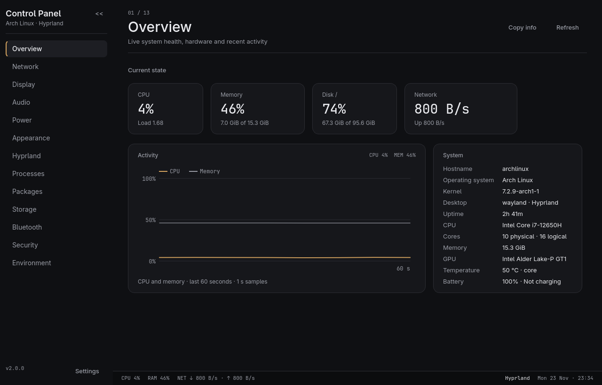

# Control Panel

Szybki, responsywny panel sterowania dla **Arch Linux + Hyprland**. Jedno okno
do podglądu stanu systemu, sieci, dźwięku, zasilania, tapet, konfiguracji
Hyprlanda, procesów, pakietów, dysków, Bluetooth, bezpieczeństwa i zmiennych
środowiskowych.



> English version: [README.md](README.md)

## Dlaczego przepisałem projekt?

Pierwotny prototyp był jednym plikiem na ~2500 linii, który większość poleceń
systemowych uruchamiał w wątku GUI. Otwarcie strony mogło zamrozić okno na kilka
sekund, a tekst pochodzący od użytkownika trafiał do poleceń powłoki.

Ta wersja zachowuje funkcje, ale zmienia fundamenty:

- **GUI nigdy nie czeka na polecenia.** Praca idzie przez ograniczoną pulę
  wątków; długie zadania (szukanie pakietów, skanowanie dysku, Bluetooth) można
  anulować.
- **Brak wstrzykiwania poleceń.** Każde polecenie to lista argumentów, nigdzie
  nie ma `shell=True`.
- **Responsywność.** Karty zawijają się w flow layoucie, sidebar zwija się przy
  wąskim oknie, strony ładują się leniwie, a tabele dopasowują się do miejsca.
- **Bezpieczne uprawnienia.** Operacje administracyjne używają `pkexec` (agent
  polkit) albo otwierają prawdziwy terminal dla `pacman`/`yay`. GUI nigdy nie
  czeka na hasło w nieistniejącym TTY.
- **Łagodna degradacja.** Brakujące narzędzia są wykrywane i opisane, zamiast
  powodować traceback albo puste strony.
- **Bezpieczna edycja plików.** Zapis atomowy + kopia `.bak`; po przeładowaniu
  Hyprland pokazuje błędy konfiguracji.

Python + PyQt6 został wybrany celowo: responsywność wynika z asynchronicznego
I/O i adaptacyjnego layoutu, a nie z języka. Port do Rust/egui miałby te same
ograniczenia i dołożyłby dużą zależność GUI. Kod jest podzielony na małe moduły,
żeby taki port był prosty.

## Funkcje

| Strona | Co robi |
| --- | --- |
| **Overview** | Karty CPU/RAM/swap/dysk/sieć/temperatura/bateria, wykresy historii, informacje o sprzęcie i systemie |
| **Network** | Interfejsy, transfer, DNS, Cloudflare DNS, czyszczenie cache, WiFi (skan/połączenie/rozłączenie/radio), ping, `nmtui` |
| **Display** | Podświetlenie, monitory, edycja reguł `monitor=`, DPMS, night light |
| **Audio** | Głośność i mikrofon PipeWire, mute, sinki/źródła, urządzenie domyślne, `playerctl` |
| **Power** | Bateria na żywo, `powerprofilesctl`, blokada/uśpienie/hibernacja/wylogowanie/restart/wyłączenie z potwierdzeniem |
| **Appearance** | Galeria tapet z miniaturami, awww/swww/hyprpaper/swaybg, paleta Matugen, motywy GTK/ikon/kursora, czcionki |
| **Hyprland** | Edytor wszystkich źródłowych plików konfiguracji, znaczniki zmian, backup, błędy, szybkie ustawienia na żywo |
| **Processes** | Sortowalna lista procesów z poprawnym CPU, wyszukiwanie, terminate/kill, usługi systemowe i użytkownika |
| **Packages** | Wyszukiwanie oficjalne + AUR, instalacja/usuwanie w terminalu, aktualizacje i pełny upgrade |
| **Storage** | Użycie systemów plików, skanowanie największych plików w tle z anulowaniem, czyszczenie cache, paccache, journal |
| **Bluetooth** | Status adaptera, zasilanie, skanowanie, parowanie/łączenie/trust/remove |
| **Security** | Firewall, konfiguracja i klucze SSH, historia logowań, nasłuchujące porty, checklista |
| **Environment** | Zmienne środowiskowe z maskowaniem sekretów, `env.conf`, edytor rc powłoki, audyt PATH |

Skróty: `Ctrl+1`…`Ctrl+9` — strony, `Ctrl+,` — preferencje, `Ctrl+R` —
odświeżenie, `Ctrl+Q` — wyjście, `Ctrl+S` — zapis w edytorze Hyprlanda.

## Wymagania

- Arch Linux (inne dystrybucje zadziałają dla większości stron, ale pakiety i
  strony Hyprlanda zakładają narzędzia Archa).
- Python **3.11+**, PyQt6, psutil.
- Opcjonalne narzędzia są wykrywane w czasie działania:

```bash
sudo pacman -S --needed \
    python python-pyqt6 python-psutil \
    networkmanager brightnessctl \
    pipewire wireplumber playerctl \
    bluez bluez-utils pacman-contrib polkit \
    openssh ufw
```

Pełny zestaw desktopowy:

```bash
yay -S --needed awww matugen hyprpaper wlsunset \
    ttf-jetbrains-mono-nerd noto-fonts
```

Zalecane terminale: `kitty`, `alacritty`, `foot`, `wezterm` lub `xterm`.

## Instalacja

```bash
git clone https://github.com/Amirelox/Control-Panel-for-Arch-Linux.git control-panel
cd control-panel
./install.sh
```

Skrypt tworzy `.venv`, instaluje pakiet, dodaje launcher
`~/.local/bin/control-panel` i wpis do menu aplikacji. Upewnij się, że
`~/.local/bin` jest w `PATH`.

Odinstalowanie launchera (katalog zostaje):

```bash
./install.sh --uninstall
```

Uruchomienie bez instalacji:

```bash
./run.sh
```

## CLI

```text
control-panel                 # normalne uruchomienie
control-panel --page Network  # otwórz stronę po nazwie lub numerze
control-panel --reset-layout  # reset geometrii i ostatniej strony
control-panel --self-test     # zbuduj wszystkie strony i wyjdź (CI)
control-panel --version
```

## Konfiguracja

Ustawienia są w `~/.config/control-panel/settings.json`: geometria okna,
ostatnia strona, sidebar, interwał odświeżania, źródło akcentu (domyślnie
`amber`; `auto` czyta `~/.config/hypr/colors.conf`), terminal, foldery tapet, potwierdzenia akcji
niszczących i limit skanowania.

Poza tym plikiem aplikacja nic nie zapisuje, dopóki sam nie edytujesz pliku
Hyprlanda lub powłoki. Wtedy powstaje kopia `<plik>.bak`.

## Rozwój

```bash
python3 -m venv .venv --system-site-packages
.venv/bin/pip install -e '.[dev]'
.venv/bin/ruff check src tests
.venv/bin/ruff format --check src tests
.venv/bin/pytest
QT_QPA_PLATFORM=offscreen .venv/bin/python -m control_panel --self-test
```

Testy pokrywają parsery, walidację ustawień, zapis atomowy, podążanie za
`source` w konfiguracji Hyprlanda, uruchamianie poleceń bez powłoki i smoke test
okna Qt.

## Bezpieczeństwo

- Brak `shell=True`; nazwy pakietów, adresy Bluetooth i nazwy usług są
  walidowane.
- Zmienne wyglądające na sekrety są domyślnie maskowane.
- Akcje systemowe używają `pkexec` lub terminala, nigdy zawieszonego `sudo`.
- Zapis konfiguracji jest atomowy, z backupem.
- Akcje niszczące wymagają potwierdzenia.
- Sprawdzanie firewalla przy wejściu na stronę nie otwiera okna polkit.

## Design

Przegląd interfejsu oparto o metodę [unslop](https://x.com/heydamir) autorstwa
Damira Sokolovsky'ego (@heydamir), na licencji CC BY 4.0.

## Licencja

MIT — patrz [LICENSE](LICENSE).
